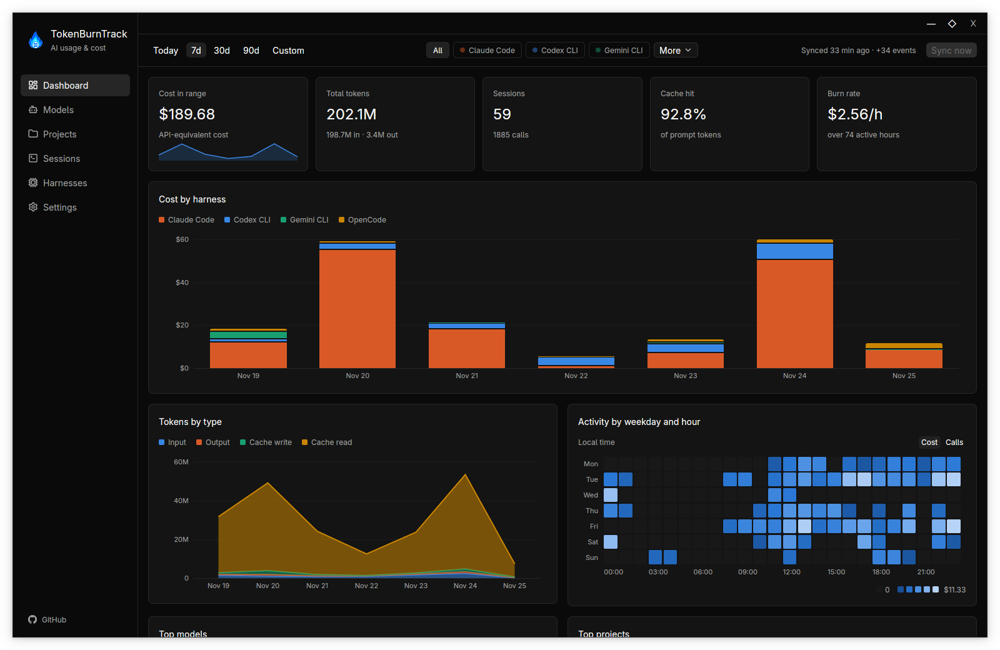

# TokenBurnTrack

A local desktop app that tracks the token usage and cost of AI coding agents. It copies
usage records from the agents' own log files into a SQLite database on your machine,
prices every API call, and shows dashboards for cost, tokens, sessions, models and
projects. Your history survives after the agents delete or rotate their logs.




## Quick start

Build from source (Rust toolchain is installed by rustup; Linux needs a Wayland session):

```sh
scripts/cargo build --release
install -Dm755 target/release/tbt-app ~/.local/bin/tbt-app
install -Dm755 target/release/tbt-daemon ~/.local/bin/tbt-daemon
~/.local/bin/tbt-daemon install --app ~/.local/bin/tbt-app   # hourly collection while the app is closed
```

Then start `tbt-app`. It syncs on startup, every hour and on *Sync now*.

Flatpak, AppImage, macOS and Windows packages, system dependencies and the daemon
options are in [docs/install.md](docs/install.md). Settings are in
[docs/configuration.md](docs/configuration.md), and tests and release builds in
[docs/development.md](docs/development.md).

## Features

- **Incremental, idempotent collection.** Each run reads only what is new, a re-run
  never counts anything twice, and a machine that slept catches up on the next run.
- **Session linking.** Resumed and forked sessions are linked instead of double counted;
  subagent runs are linked to the session that started them.
- **Worktree projects.** Sessions run in a git worktree count toward the main checkout's
  project, also after the worktree is deleted if it was seen before, is a Claude Code
  `.claude/worktrees` worktree, or git still lists it.
- **Per-call cost.** Bundled prices, an optional LiteLLM import and your own overrides,
  versioned by date so a price change does not rewrite old costs. When a harness logs
  its own cost, both values are kept.
- **Dashboards.** KPIs, hourly/daily cost, tokens by type, top models and projects, a
  weekday × hour heatmap, a sessions table with session detail, and CSV/JSON export.
- **Background collector.** `tbt-daemon` runs from a systemd user timer, a launchd agent
  or a Windows scheduled task, and shares a lock with the app so only one ingests at a
  time.

## Supported harnesses

| Harness | Reads | Override |
|---|---|---|
| Claude Code | `~/.claude/projects/**/*.jsonl` (sessions and subagent runs) | `CLAUDE_CONFIG_DIR` |
| Codex CLI | `~/.codex/sessions/YYYY/MM/DD/*.jsonl` | `CODEX_HOME` |
| Gemini CLI | `~/.gemini/tmp/<project>/chats/*.jsonl` and legacy `session-*.json` (macOS also `~/.cache/.gemini/tmp`) | `GEMINI_CLI_HOME` |
| Grok Build | `~/.grok/sessions/<cwd>/<session>/usage.json` (subagent sessions are skipped; their usage is already in the parent) | `GROK_HOME` |
| OpenCode | `~/.local/share/opencode/opencode.db` (opened read-only) | `XDG_DATA_HOME` |
| Cursor | `~/.config/Cursor/User/globalStorage/state.vscdb` (opened read-only; macOS `~/Library/Application Support/Cursor`, Windows `%APPDATA%\Cursor`) | `XDG_CONFIG_HOME` |
| GitHub Copilot CLI | `~/.copilot/session-state/<session-id>/events.jsonl` | `COPILOT_HOME` |
| Antigravity | `~/.gemini/{antigravity,antigravity-insiders,antigravity-cli}/conversations/*.db` (app, Insiders and CLI; opened read-only) | `GEMINI_CLI_HOME` |
| Generic JSONL | any JSONL log you describe in `config.toml` | `[[generic_jsonl]]` |

Source files are only ever read. Roots can be changed per harness on the Harnesses page.
The Gemini CLI and Grok Build parsers were built from upstream source rather than real
logs, so treat their numbers with more caution. The same goes for Cursor, whose chat
database format is not documented: it reads the agent and chat panel's per-message
`tokenCount`, which Cursor does not fill in for every model, and it does not read the
`cursor-agent` CLI. The GitHub
Copilot CLI parser was also built from the published event schema, not real logs. Copilot
does not write per-call usage to disk, only per-model running totals at checkpoints and at
shutdown, so each usage row covers the calls since the previous total, and only the CLI is
read, not Copilot in VS Code or other editors. The Antigravity parser is the least certain:
Antigravity keeps token counts in undocumented protobuf blobs, and the field layout comes
from other open-source usage trackers, not from Google or from real logs. Model names come
from the model picker label (`Gemini 3.6 Flash (High)` → `gemini-3.6-flash`), or from the
response model when it extends that name (`gemini-3.1-pro-preview`), so the thinking level
is not priced separately. Messages are not read.

## Privacy

Everything stays on your machine. The data directory
(`~/.local/share/tokenburntrack` on Linux) holds:

- `tbt.sqlite`: sessions, one row per API call (time, harness, provider, model, token
  counts by type, computed and reported cost, project path, git branch, and the raw
  usage JSON unless `raw_json_retention_days` drops it), hourly rollups, prices and a
  log of ingest runs;
- `collector.lock`: the lock shared by the app and the daemon;
- `daemon.lock`: held by a long-running `tbt-daemon`, so only one runs per data
  directory;
- `logs/`: daily-rotated daemon logs (30 days kept).

Message content depends on the `privacy` setting:

| Level | Stored per message |
|---|---|
| `off` | nothing |
| `metadata_only` (default) | role, kind, tool name, timestamps; no text |
| `truncated_preview` | the above plus the first 280 characters of the text |

Nothing is sent anywhere. The only network access is the optional LiteLLM price import,
which downloads the public price list when you click it in Settings. The systemd unit
runs the daemon without network access.

## License

Copyright (C) 2026 vaguemotion

TokenBurnTrack is free software: you can redistribute it and/or modify it under the
terms of the GNU General Public License as published by the Free Software Foundation,
either version 3 of the License, or (at your option) any later version. See
[`LICENSE`](LICENSE).
